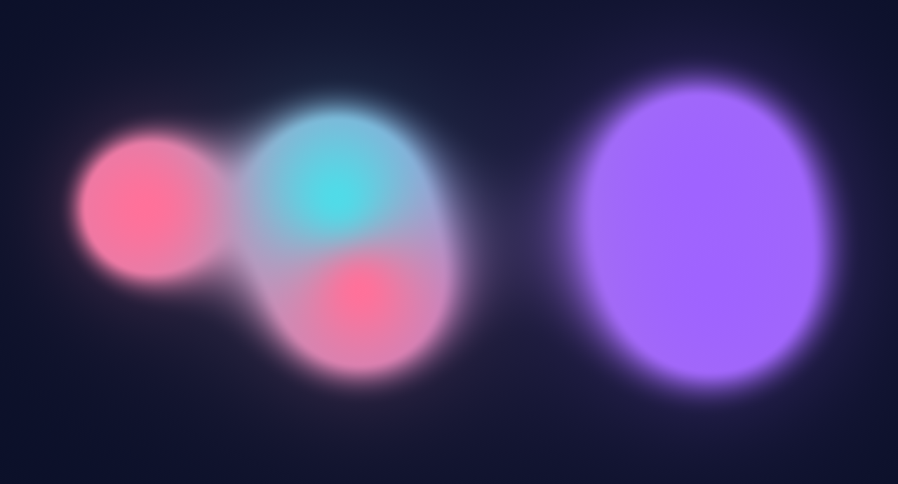
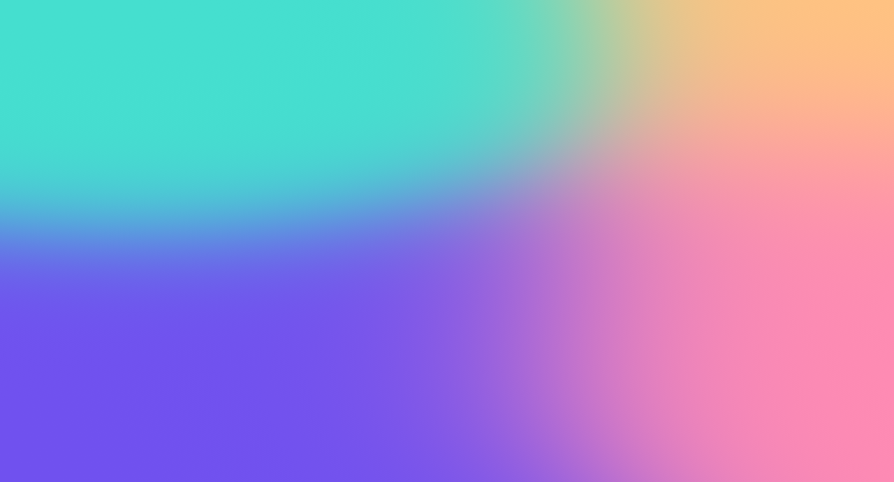
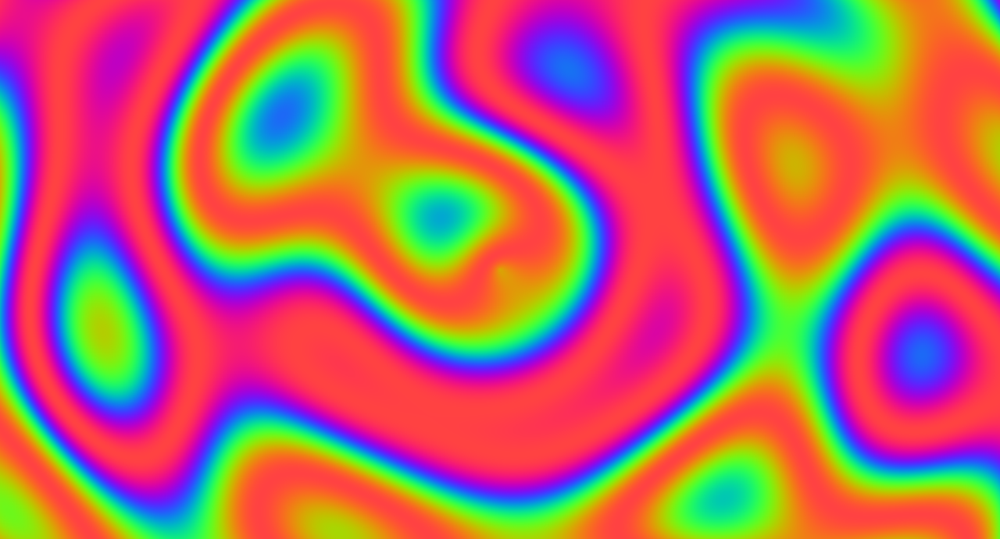
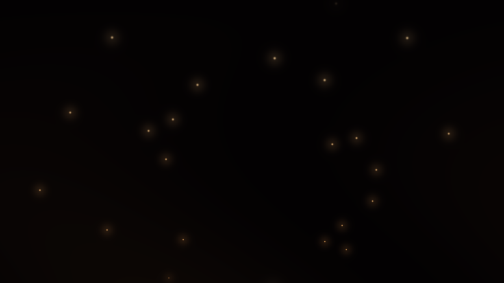
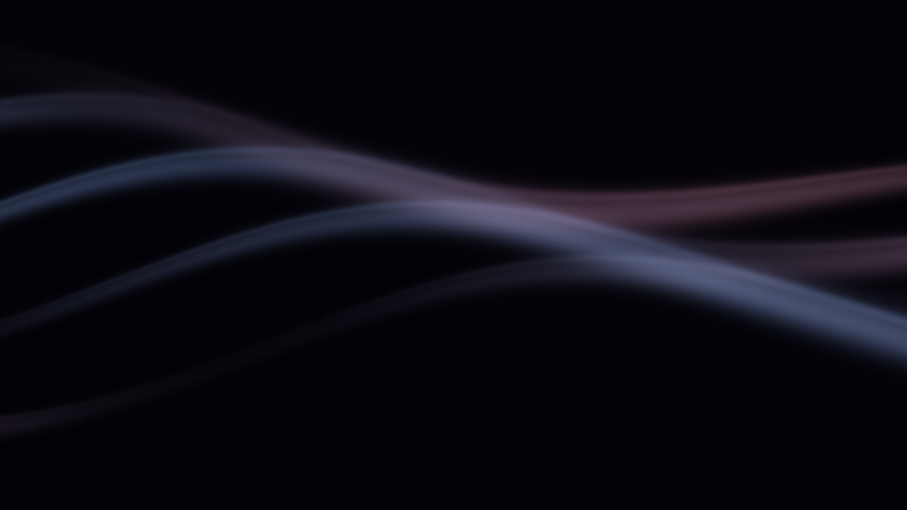
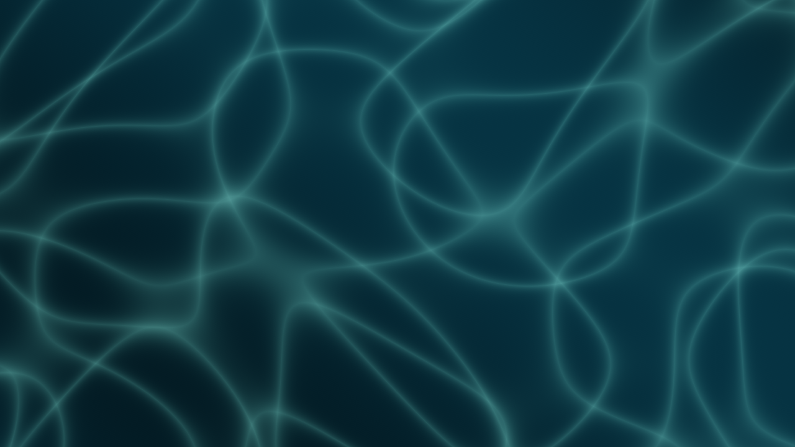
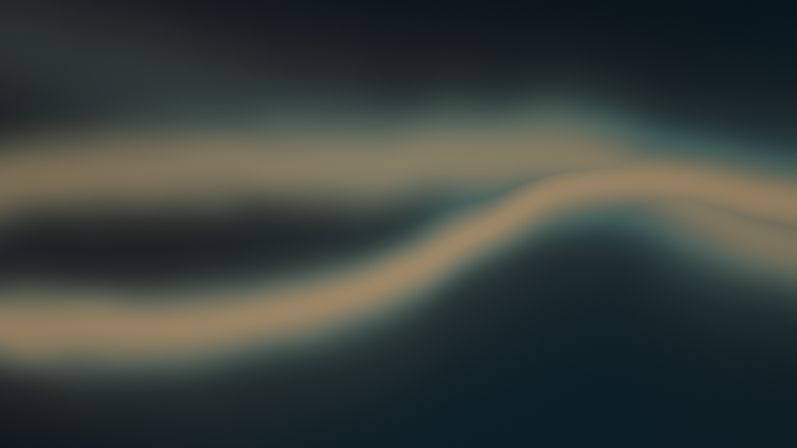

# scrnsvr

A shader-based idle screensaver for Hyprland and other Wayland desktops with `wlr-layer-shell`. A native Rust app draws GLSL shaders with OpenGL ES straight into overlay surfaces on your monitors, with a clock, a stack of GPU effects and a settings window to browse, preview and tune everything. There is no Electron, Node or web view: one AppImage holds three small programs.

scrnsvr does not watch for idle on its own. Your idle service (Noctalia's, or hypridle) runs `scrnsvr --open` when the desktop has been idle, and any input dismisses it.

[User documentation](docs/README.md) · [Download](https://github.com/rigerc/scrnsvr/releases/latest)

## Gallery

Click a screenshot to watch the 5-second animated preview (H.264 MP4, ~640px).

| | | |
|---|---|---|
| [](assets/videos/aurora-veil.mp4) | [](assets/videos/flow-field.mp4) | [](assets/videos/gradient-blobs.mp4) |
| **Aurora Veil** · [video](assets/videos/aurora-veil.mp4) | **Flow Field** · [video](assets/videos/flow-field.mp4) | **Gradient Blobs** · [video](assets/videos/gradient-blobs.mp4) |
| [](assets/videos/gradient-drift.mp4) | [](assets/videos/interference.mp4) | [](assets/videos/mesh-gradient.mp4) |
| **Gradient Drift** · [video](assets/videos/gradient-drift.mp4) | **Orbital Interference** · [video](assets/videos/interference.mp4) | **Mesh Gradient** · [video](assets/videos/mesh-gradient.mp4) |
| [](assets/videos/plasma.mp4) | [](assets/videos/contour-dunes.mp4) | [](assets/videos/ember-drift.mp4) |
| **Chromatic Plasma** · [video](assets/videos/plasma.mp4) | **Contour Dunes** · [video](assets/videos/contour-dunes.mp4) | **Ember Drift** · [video](assets/videos/ember-drift.mp4) |
| [](assets/videos/silk-ribbons.mp4) | [](assets/videos/star-drift.mp4) | [](assets/videos/tidal-caustics.mp4) |
| **Silk Ribbons** · [video](assets/videos/silk-ribbons.mp4) | **Star Drift** · [video](assets/videos/star-drift.mp4) | **Tidal Caustics** · [video](assets/videos/tidal-caustics.mp4) |
| [](assets/videos/dune-silk.mp4) | | |
| **Dune Silk** · [video](assets/videos/dune-silk.mp4) | | |

The media in `assets/` was captured by the 0.x releases at 1280×720 (stills) and 640px, 12 fps (video).

## Features

- 54 GLSL shaders, from quiet ambient gradients and fine line art to material studies and the three audio-themed visuals (see [Fresh start](#fresh-start-coming-from-0x))
- 10–17 controls per shader, grouped into Motion, Shape and Color, with Advanced adjustments, exact numeric entry, per-control reset, locks, conservative Randomize, Undo and saved looks
- Global GPU effect stack: 17 adjustable effects, including VHS/CRT, film, pixel/dither, optics, bloom and persistent datamosh/trails; up to eight independent layers, reorder and bypass, live preview
- Clock overlay: 12h/24h, seconds and date, nine positions, font/weight/size/color/opacity/margin/shadow, and an optional strftime pattern
- 30 color schemes and Noctalia color import (`mPrimary`, `mSecondary`, `mTertiary`, `mSurface`, `mOnSurface` onto shader color controls)
- Custom GLSL shader editor with live compile errors on the offending line
- Shuffle through a list of visuals and saved looks on a timer
- Thumbnail tiles rendered on your GPU, and a fullscreen preview that uses the real saver
- Noctalia idle setup (`--setup-noctalia`) and a single-instance `--open`, with `--dismiss` to close it
- Primary or all-monitors rendering; frames are drawn only when the compositor asks for one, so a monitor that is off or covered costs nothing

## Requirements

- **Hyprland** is the supported desktop. Other Wayland compositors with `wlr-layer-shell` (Sway and others) may work but are not promised or tested. GNOME and X11 are unsupported.
- A Wayland session with `wlr-layer-shell` and a GPU with OpenGL ES 2.0 over EGL for the saver.
- **Vulkan** for the settings window (GPUI renders through wgpu). The saver itself does not need Vulkan.
- **glibc 2.35 or newer** for the release AppImage (Ubuntu 22.04 and Debian 12 or newer).
- Host libraries the AppImage does not bundle: pango, cairo, glib, fontconfig, freetype, harfbuzz, libxkbcommon, libxcb, Wayland, EGL and Vulkan. A desktop install has them.
- Optional: Noctalia 5.x or `hypridle` to start the saver when idle. Inter Tight is used for the settings window if installed, else Liberation Sans.

## Install

1. Download `Scrnsvr-<version>-x86_64.AppImage` and `SHA256SUMS-<version>-native.txt` from the release page, then check and mark it executable:

   ```sh
   sha256sum -c SHA256SUMS-<version>-native.txt
   chmod +x Scrnsvr-<version>-x86_64.AppImage
   ```

2. Link a stable `scrnsvr` command to it (`~/.local/bin/scrnsvr`, or `$XDG_BIN_HOME/scrnsvr`), so idle commands never name a versioned file:

   ```sh
   ./Scrnsvr-<version>-x86_64.AppImage --install
   ```

   Make sure `~/.local/bin` is on `PATH`. After you replace the AppImage with a newer version, run `--install` again.

3. Start it when idle. With Noctalia, preview and then apply the setup; otherwise use hypridle or a hot corner:

   ```sh
   scrnsvr --setup-noctalia            # dry run: shows what would change
   scrnsvr --setup-noctalia --apply    # writes it through `noctalia msg config-set`
   ```

   hypridle (`~/.config/hypr/hypridle.conf`):

   ```
   listener {
       timeout = 600
       on-timeout = scrnsvr --open
   }
   ```

   A Noctalia (or Hyprland) hot corner can run `scrnsvr --open` directly. The desktop entry for launchers comes with the AppImage; start `scrnsvr` with no arguments for the settings window.

### Fresh start (coming from 0.x)

1.0.0 is a rewrite, and it starts clean:

- Settings live in `$XDG_CONFIG_HOME/scrnsvr/config.toml` (`~/.config/scrnsvr/config.toml`). The old Electron `config.json` is **not read or migrated**, so shaders, effects and clock start at their defaults and favorites start empty.
- **Reactive audio was removed.** Quiet Horizon, Velvet Cloud and Lightwell show their quiet state, and custom shaders that read `uAudio` receive zeros.
- There is no built-in idle daemon or systemd user service; `scrnsvr --daemon` exits 2 with a pointer to Noctalia and hypridle. Remove an old `scrnsvr.service` and any Noctalia command that points at an old AppImage.
- The AppImage is the only package; there is no `.deb`.

## Usage

| Command | What it does |
|---|---|
| `scrnsvr` / `scrnsvr --settings` | Open the settings app |
| `scrnsvr --open [--shader <id>]` | Start the full-screen saver; any key, click or pointer movement dismisses it |
| `scrnsvr --dismiss` | Fade out a running saver (exits 0 when none runs) |
| `scrnsvr --preview [--shader <id>]` | Resizable 960×540 preview window, never shuffles |
| `scrnsvr --thumbnail [--output <dir>] [--frames <n>]` | Render a 640×360 PNG for every built-in shader (default `assets/thumbnails`, 3 frames) |
| `scrnsvr --install [--force]` | Link `~/.local/bin/scrnsvr` (or `$XDG_BIN_HOME/scrnsvr`) to the AppImage or this binary |
| `scrnsvr --setup-noctalia [--apply] [--timeout N]` | Show, or with `--apply` write, the Noctalia idle setup |
| `scrnsvr --help` | Print usage |

`--open` is safe to trigger repeatedly: while a saver runs, another `--open` exits 0. If the saver cannot run (no Wayland session or no `wlr-layer-shell`), it reports the reason and exits 1.

The saver:

- fades in from the desktop over the configured time, and fades back out when dismissed;
- is dismissed on every monitor by a key, click, scroll, touch, or pointer movement beyond 12 logical pixels;
- closes if an output is added, removed or changes scale (the next launch selects outputs again);
- uses the output at logical position (0,0) as the primary one, else the first, when only the primary monitor is configured.

Set `SCRNSVR_RENDERER_DEBUG=1` for per-second frame statistics on stderr.

### Idle with Noctalia

`scrnsvr --setup-noctalia` reads `noctalia msg config-get idle`. It reuses an existing behavior that runs scrnsvr, or creates `idle.behavior.scrnsvr` (default timeout 600 s), and sets `idle.pre_action_fade_seconds` to 0 so only scrnsvr fades. It writes only through `noctalia msg config-set`, never by editing Noctalia's files, and only with `--apply`. Noctalia respects Wayland idle inhibitors and `org.freedesktop.ScreenSaver` inhibits, so a video in a browser keeps the saver away.

### Settings

`scrnsvr --settings` opens the settings window. A live preview, a shader bank and an inspector built from each shader's manifest sit in the Visuals tab: thumbnail tiles with search, favorites and categories, sliders with exact entry, color pickers, selects, switches, an Advanced section, per-control Reset, Reset shader, Randomize with locks, Undo, and saved looks. Edits save automatically with a visible status and a Retry that keeps your edits after a failed save. It needs Wayland and Vulkan; with reduced animations set on the desktop, the preview starts paused. Tabs move with Left/Right/Home/End.

- **Visuals:** shader bank, inspector, per-visual color scheme, Noctalia color import.
- **Effects:** one global stack of up to eight layers (add, remove, reorder with buttons or Alt+Up/Down, enable per layer or globally), live in the preview.
- **Looks & Shuffle:** saved looks, the shuffle list and its timing.
- **Clock:** every clock option, a placement grid, and an optional strftime pattern with a live example.
- **Settings:** frame rate, fade, monitors, global color scheme and the Idle section. It shows whether Noctalia launches scrnsvr, edits Noctalia's timeout, and offers "Set up…", which lists the `noctalia msg config-set` changes and applies them only after you confirm. Without Noctalia it shows hypridle and hot-corner instructions.

Favorites and other interface state live in `$XDG_STATE_HOME/scrnsvr/ui.toml` (`~/.local/state/scrnsvr/ui.toml`). Thumbnails are cached in `$XDG_CACHE_HOME/scrnsvr/thumbnails/`.

### Custom shaders

Select **Add shader** in the shader bank to write a single-pass GLSL ES 1.00 shader. Use `mainImage` or `main`; `uTime`, `uResolution`, `iTime`, `iResolution`, `iMouse`, `iDate` and `uAudio` are supplied; textures and `#version` are not allowed. Edits are checked with a real GLES compile and saved automatically; errors appear on the offending line, and the preview keeps the last valid version. Import a `.glsl` or `.frag` file (up to 100 KB) or delete a shader from the same panel. Custom shaders can be favorited, shuffled and combined with effects. **Fullscreen preview** shows the current visual the way the saver does. The editor creates visuals, not post-processing effects.

### Shader controls

Choose a shader and adjust its sliders for a live preview. Numeric fields accept precise values when you press Enter or leave the field. Each control has its own Reset button; Reset shader restores all defaults. Open **Advanced** for finer motion, geometry and color adjustments. Randomize respects slider steps and conservative motion ranges while keeping background colors unchanged.

Every shader supports speed, brightness and saturation. Speed at zero freezes animation; saturation at zero produces grayscale. Plasma's **Custom** palette exposes three color controls, and Flow Field's **Duotone** palette exposes a secondary color.

### Global effects

Open **Effects**, choose an effect and click **Add effect** to process any built-in or custom visual. Every effect has an **Intensity** control to blend with the original image; zero bypasses that layer. Effects start empty.

| Effect | Treatment and adjustments |
| --- | --- |
| VHS Distortion | Analog tape grain, scanlines, color bleed, and tracking distortion |
| CRT Monitor | Curved glass, phosphor mask, scanlines, and screen-edge falloff |
| Analog Film | Fine grain, warm/cool response, faded blacks, and slow exposure drift |
| Pixelate | Pixel block size and grid aspect |
| Ordered Dither | Bayer pattern size, color levels, and threshold strength |
| Chromatic Aberration | Color-channel separation amount, direction, and edge bias |
| Kaleidoscope | Mirrored segment count, rotation, center, and zoom |
| Dream Blur | Soft blur with adjustable radius |
| Digital Glitch | Occasional local block displacement, frequency, band size, and color split |
| Lens Distortion | Barrel/pincushion distortion, center, and zoom |
| Color Grade | Warmth, tint, contrast, saturation, and faded blacks |
| Vignette | Colored edge shading with radius, softness, and strength |
| Bloom | Thresholded highlights with separable blur radius and glow strength |
| Liquid Glass | Drifting refraction waves with scale, speed, and strength |
| Halftone Print | Rotated luminance-driven dots, dot size, and inverted ink |
| Datamosh / Trails | Persistent frame feedback with smooth-trail/block-displacement modes, persistence, decay, and displacement |
| Palette Mapping | Luminance mapped to Neon, Ember, Ocean, or Monochrome ramps |

Stack up to eight layers, including several independently adjusted instances of the same effect. They run top to bottom; order matters (blur before pixelation differs from pixelation before blur). Each layer can be disabled, reset or removed, and **Enable effects** bypasses the whole stack without deleting your adjustments.

The stack is global: changing visuals, applying saved looks, randomizing, changing color schemes or shuffling keeps the same effects. The live preview, fullscreen preview and saver show the result; thumbnails stay clean. The clock stays crisp above the processed image. Animated effects use their own timeline, so VHS, film, glitch and refraction continue when a visual's Speed is zero; **Pause animation** freezes both, including temporal history. Unavailable or failed effects are skipped rather than blanking the visual.

Bloom uses multiple GPU passes, and Datamosh / Trails keeps previous-frame textures for each instance, so they cost more GPU time and memory than single-pass effects, especially at high resolutions. History resets when its input stack, settings or dimensions change, and disabling effects or setting Intensity to zero releases unused targets.

### Color schemes

Pick one of 30 well-known color schemes (Dracula, Nord, Gruvbox, Solarized, Monokai, One Dark, Tokyo Night, Night Owl, Palenight, Zenburn, Ayu, Rosé Pine, Kanagawa, GitHub, Material, Everforest, Iceberg and more) under **Settings → Color scheme**. The scheme supplies background, text and accent colors to every shader that exposes color controls, using the same role mapping as the Noctalia import. Each visual can override the global choice or opt out with **Built-in colors** in its Colors section; choosing a scheme clears that visual's color edits, and Randomize leaves scheme colors alone.

### Configuration

`config.toml` uses snake_case keys. Invalid or unknown values fall back to defaults with a warning rather than discarding the file; a malformed file is reported and left untouched. Saves are debounced, atomic (temp file, sync, rename) and retried without losing edits. Example:

```toml
shader = "gradient-blobs"

[global]
fps = 60
fade_seconds = 1.0
monitors = "primary"          # or "all"

[clock]
enabled = true
position = "center"           # top-left … bottom-right
format = "24h"                # or "12h"
show_date = true
pattern = "%H:%M"             # optional strftime pattern for the time line

[colors]
scheme = "nord"               # "none" keeps each shader's own colors

[rotation]                    # the shuffle list
enabled = true
interval_minutes = 10.0
[[rotation.entries]]
shader = "plasma"
preset = "Evening"            # optional saved look

[[effects.layers]]
id = "tape-1"
effect_id = "vhs-distortion"
enabled = true
values = { intensity = 0.5, grain = 0.2 }

[shaders.plasma]
speed = 0.65

[presets.plasma.Evening]      # saved looks
speed = 0.25
color1 = "#1122ff"
```

## Building

You need Rust 1.88 or newer and the development packages for pango, cairo, glib, Wayland, EGL/GLES, xkbcommon, xcb, fontconfig, freetype and Vulkan (on Debian/Ubuntu see `packaging/native/Containerfile.builder` for the exact list). No Node, npm or C++ is involved.

```sh
scripts/check.sh                       # cargo test --workspace --locked, clippy -D warnings, fmt --check
cargo run --release -p scrnsvr-settings   # settings; judge responsiveness in release, debug GPUI is slow
cargo build --release --locked -p scrnsvr-app -p scrnsvr-settings   # target/release/{scrnsvr,scrnsvr-renderer,scrnsvr-settings}
scripts/build-appimage.sh              # release/native/Scrnsvr-<version>-x86_64.AppImage + SHA256SUMS-<version>-native.txt
scripts/build-appimage-container.sh    # the same in an Ubuntu 22.04 container (glibc 2.35): use this for releases
scripts/check-appimage.sh <AppImage>   # smoke test on a live Hyprland session (needs hyprctl, grim, jq)
```

- Plain `cargo build` and `cargo test` cover the saver crates only; `scrnsvr-settings` pulls in GPUI (wgpu/Vulkan), so name it with `-p scrnsvr-settings` or `--workspace`. `cargo tree -p scrnsvr-app` has no GPUI crates, so the saver never depends on Vulkan.
- The tests include headless GPU tests that compile every built-in shader and effect on your GLES driver and render representative frames. They skip with a note on a machine without EGL.
- `scripts/build-appimage.sh` packages the three binaries with a pinned, checksum-verified `appimagetool` and type2 runtime (cached in `target/appimage-cache`) and a reproducible timestamp. `SCRNSVR_MAX_GLIBC=2.35` fails the build if a binary needs a newer glibc.
- `scripts/build-appimage-container.sh` needs podman or docker and git. It builds the **committed `HEAD`** (`git archive`; uncommitted changes are not built) in a pinned Ubuntu 22.04 image with Rust 1.99.1, and keeps its caches under `target/`, so reruns take seconds.
- `scripts/check-appimage.sh` runs against a temporary XDG tree and never touches your real configuration, Noctalia or `~/.local/bin`.

### Shader and palette sources

The built-in catalog is plain files under `data/`, assembled at compile time by `crates/scrnsvr-core/build.rs`:

- `data/shaders/<id>/manifest.json` (id, title, category, description, controls) and `shader.glsl` (exports `mainImage`)
- `data/effects/<id>/manifest.json` with `effect.glsl` (and `pass-*.glsl` for multipass effects); `data/effects/order.json` sets the effect order
- `data/palettes.json` and `data/color-families.json` for the color schemes

To add a shader, create its directory with those two files and rebuild. `crates/scrnsvr-core/tests/catalog_sources.rs` compares the assembled catalog with a frozen copy from the last TypeScript release (`tests/fixtures/catalog.json`), so intentional changes to the built-ins update that fixture too. See [data/README.md](data/README.md) for manifest fields. Shader provenance and licenses are in [THIRD_PARTY_SHADERS.md](THIRD_PARTY_SHADERS.md).

## Project layout

- `crates/scrnsvr-core/` — configuration (TOML), catalog, scene resolution, presets and rotation, clock formatting, the renderer protocol, Noctalia client, thumbnails; `build.rs` assembles the catalog from `data/`. No windowing or GL.
- `crates/scrnsvr-render/` — the GLES2 renderer: shader programs, uniforms, effect passes and history, fades, the Pango/Cairo clock
- `crates/scrnsvr-platform/` — dynamically loaded EGL, wlr-layer-shell outputs, seats and frame callbacks, the preview window
- `crates/scrnsvr-app/` — `scrnsvr` (CLI, saver supervision, install, Noctalia setup, preview, thumbnails) and `scrnsvr-renderer` (the saver process)
- `crates/scrnsvr-settings/` — `scrnsvr-settings`, the GPUI Kit settings app with an inline GLES preview
- `data/` — the built-in shader, effect and palette sources (see above)
- `reference/` — the Ghostty/iTerm2 color-scheme YAMLs that `data/palettes.json` was curated from (not read at build or run time)
- `packaging/native/` — desktop entry and the Ubuntu 22.04 builder image
- `scripts/` — `check.sh`, `build-appimage.sh`, `build-appimage-container.sh`, `check-appimage.sh`
- `docs/` — [Starlight user documentation](docs/README.md), [architecture decisions](docs/decisions/), the [rewrite plan](docs/rust-rewrite-plan.md) and [checklist](docs/rust-rewrite-checklist.md), and research notes

See [ADR-0003](docs/decisions/0003-native-rust-app.md) for the architecture.
