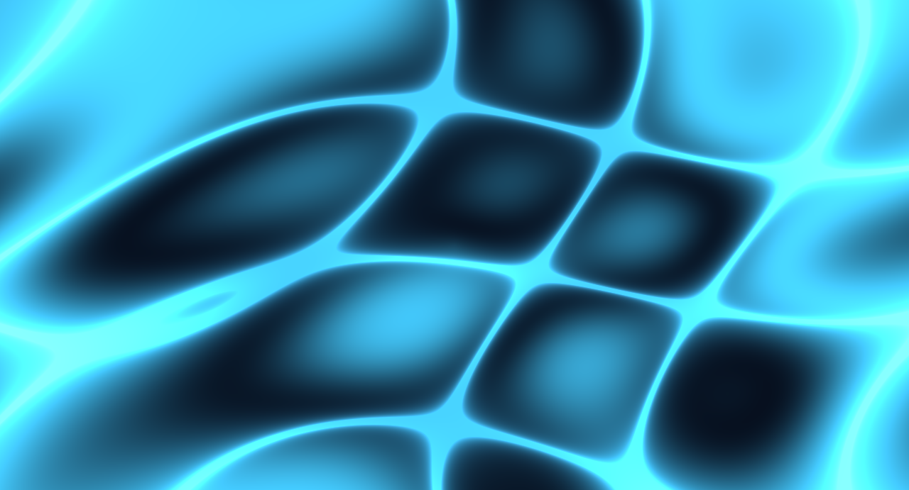
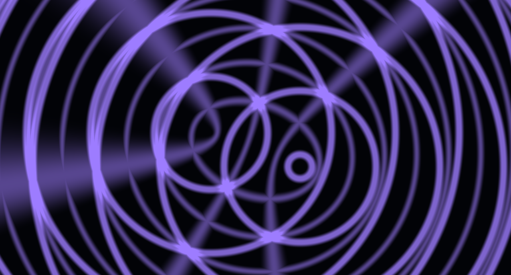
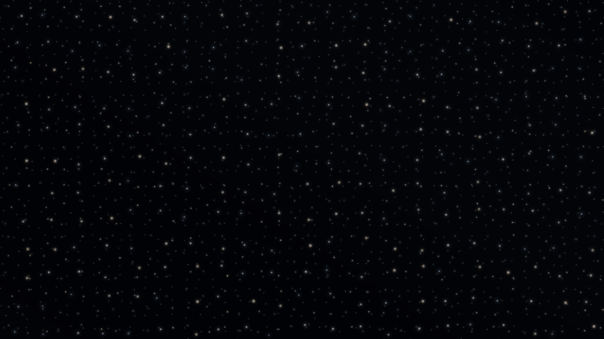

# scrnsvr

A shader-based idle screensaver for Wayland desktops with `wlr-layer-shell`. After a configurable idle timeout, a native OpenGL ES renderer draws the shaders into overlay surfaces; Electron provides the settings UI, previews and idle daemon. Includes a clock overlay and systemd user service.

## Gallery

Click a screenshot to watch the 5-second animated preview (H.264 MP4, ~640px).

| | | |
|---|---|---|
| [](assets/videos/aurora-veil.mp4) | [](assets/videos/flow-field.mp4) | [](assets/videos/gradient-blobs.mp4) |
| **Aurora Veil** · [video](assets/videos/aurora-veil.mp4) | **Flow Field** · [video](assets/videos/flow-field.mp4) | **Gradient Blobs** · [video](assets/videos/gradient-blobs.mp4) |
| [](assets/videos/gradient-drift.mp4) | [](assets/videos/interference.mp4) | [](assets/videos/mesh-gradient.mp4) |
| **Gradient Drift** · [video](assets/videos/gradient-drift.mp4) | **Orbital Interference** · [video](assets/videos/interference.mp4) | **Mesh Gradient** · [video](assets/videos/mesh-gradient.mp4) |
| [](assets/videos/plasma.mp4) | [](assets/videos/contour-dunes.mp4) | [](assets/videos/ember-drift.mp4) |
| **Chromatic Plasma** · [video](assets/videos/plasma.mp4) | **Contour Dunes** · [video](assets/videos/contour-dunes.mp4) | **Ember Drift** · [video](assets/videos/ember-drift.mp4) |
| [](assets/videos/silk-ribbons.mp4) | [](assets/videos/star-drift.mp4) | [](assets/videos/tidal-caustics.mp4) |
| **Silk Ribbons** · [video](assets/videos/silk-ribbons.mp4) | **Star Drift** · [video](assets/videos/star-drift.mp4) | **Tidal Caustics** · [video](assets/videos/tidal-caustics.mp4) |
| [](assets/videos/dune-silk.mp4) | | |
| **Dune Silk** · [video](assets/videos/dune-silk.mp4) | | |

Media is captured headlessly at 1280×720 (stills) / 640px 12 fps (video) via `scripts/capture-frames.cjs` + ffmpeg:

```sh
npx electron scripts/capture-frames.cjs --shader plasma --out /tmp/frames-plasma --frames 61 --fps 12 --width 1280 --height 720
ffmpeg -framerate 12 -i /tmp/frames-plasma/frame-%03d.png -vf "scale=640:-2" -c:v libx264 -pix_fmt yuv420p -crf 23 -movflags +faststart assets/videos/plasma.mp4
```

## Features

- 41 GLSL shaders, from quiet ambient gradients to reactive audio effects
- 10–17 controls per shader, grouped into Motion, Shape, and Color, with Advanced adjustments, numeric entry, individual resets, and saved presets
- Global GPU effect stack: 17 adjustable effects, including VHS/CRT, film, pixel/dither, optics, bloom, and persistent datamosh/trails; independent layers, reorder and bypass, live preview
- Clock overlay: 12h/24h, seconds/date toggles, 9 positions, font/weight/size/color/opacity/margin/shadow
- Noctalia colors import: maps `mPrimary/mSecondary/mTertiary/mSurface/mOnSurface` onto shader color uniforms
- Idle daemon: polls `powerMonitor.getSystemIdleTime()` with a `logind` (`busctl`) fallback; suppresses relaunch for one poll after resume
- Primary / all-monitors rendering, configurable FPS (1–240)
- Native Wayland renderer: shaders draw straight into layer-shell overlays with OpenGL ES, paced by the compositor
- Settings window by default (argless or `--settings`); screensaver via `--open`; windowed shader preview via `--preview --shader <id>`; headless thumbnail capture (`--thumbnail`)
- Config at `~/.config/scrnsvr/config.json` (or `$XDG_CONFIG_HOME/scrnsvr/config.json`), Zod-validated with atomic writes
- Linux packaging: AppImage + deb via electron-builder, ships a systemd user unit (`scrnsvr.service`)

## Requirements

- Linux with Node 24 + npm, and a Wayland compositor with `wlr-layer-shell` to run the screensaver
- Electron 44 (devDependency, allowed via `allowScripts`)
- `busctl` only if you rely on the logind idle fallback (Wayland without Electron idle data)
- Native renderer build: C/C++ compiler, `pkg-config`, `wayland-scanner`, and development headers for `wayland-client`, `wayland-egl`, EGL, GLESv2 and `pangocairo` (on Debian/Ubuntu: `libwayland-dev libwayland-bin libegl-dev libgles-dev libpango1.0-dev`). Packaged builds include the renderer.

## Quick start

```sh
npm install
npm run build

# Open settings (default, no flags needed)
npm run settings

# Run the screensaver now
npx electron dist/main/index.js --open
# Preview a shader in a window
npm start -- --preview --shader gradient-blobs

# Run the idle daemon in the foreground
npm run daemon

# Typecheck / tests
npm run typecheck
npm test
# Chromium/WebGL rendering and settings integration checks (desktop or Xvfb)
npm run check-shaders
npm run check-effects
```

CLI flags (`src/main/cli.ts`): `--settings|-s`, `--open`, `--daemon`, `--preview`, `--shader <id>`, `--thumbnail`, `--output <dir>`, `--frames <n>`.

### Native Wayland renderer

On Wayland compositors with `wlr-layer-shell` (Hyprland, Sway, KDE Plasma and others; GNOME does not provide it, see [compatibility](https://github.com/wmww/gtk-layer-shell#supported-desktops)), the screensaver runs as a small native program, `scrnsvr-renderer`. It renders the same shaders, effects and clock with OpenGL ES directly into an overlay surface on each selected monitor, covering panels and fullscreen applications. The Electron main process resolves the scene (presets, color schemes, effects, rotation, clock text, audio) and streams it to the renderer. Settings, previews and thumbnails stay in Electron.

- Activation crossfades from the desktop into the scene over the configured fade time; dismissal fades back.
- Frames are drawn only when the compositor asks for one, so a monitor that is off or covered costs nothing.
- Keyboard, click, scroll, touch, or pointer movement beyond 12 logical pixels dismisses the screensaver on all monitors.
- If an output is added, removed, or changes scale, the screensaver closes; the daemon selects outputs again on its next launch.

This is the only screensaver backend; there is no fullscreen Electron window fallback. Without a Wayland session or a built renderer, `--open` reports the reason and exits, and `--daemon` exits with status 2, which the systemd unit does not restart. If the renderer fails during a launch, the daemon logs the error and tries the native renderer again on its next idle launch.

```sh
# Build the renderer on its own
npm run build:native
# Package the app (requires a successful native build)
npm run dist
# Compile every shader and effect with the native GLES compiler
npm run check-native
# Also show the screensaver briefly on the primary output and check fades,
# transitions, broken-scene recovery and dismissal from real screen pixels (needs grim, hyprctl)
node scripts/check-native.cjs --live
# Per-second frame statistics on stderr
SCRNSVR_RENDERER_DEBUG=1 npx electron dist/main/index.js --open
```

`npm run build` attempts the native build and continues without it if development dependencies are missing; settings and previews still work, but the screensaver cannot run until `npm run build:native` succeeds. See [ADR-002](docs/decisions/0002-native-renderer.md) for the design.

#### Rust renderer (opt-in)

The [Rust rewrite](docs/rust-rewrite-plan.md) includes a drop-in replacement for the C++ renderer, built from the Cargo workspace in `crates/`. It accepts the same arguments, JSON-lines messages and exit codes. The C++ renderer remains the default and the rollback path. The Rust build needs a Rust toolchain (`rust-version` in `Cargo.toml`) and the same Wayland, EGL and `pangocairo` development files; `wayland-scanner` and GLES headers are not needed.

```sh
# Build the app with the Rust renderer in dist/native/scrnsvr-renderer
npm run build:rust            # same as SCRNSVR_RENDERER=rust npm run build
# Rust unit tests, headless GPU tests, Clippy and rustfmt
npm run test:rust
# Capture every built-in shader, effect and the clock headless with both renderers
# at a fixed frame delta and compare pixels (both binaries accept --capture PATH --size WxH --frames N --delta MS)
npm run check-parity
# Refresh the scene-plan fixtures the Rust protocol tests parse and the settings spike's catalog
node scripts/export-rust-fixtures.cjs
# Settings spike (GPUI Kit; needs Vulkan). Build in release: debug GPUI is too slow to judge.
# SCRNSVR_SETTINGS_SMOKE=steps runs a scripted check and prints each step.
cargo run --release -p scrnsvr-settings
```

#### Native app command line (rewrite branch)

The native Rust app replaces Electron at the 1.0.0 cutover. Its configuration is `~/.config/scrnsvr/config.toml`; it does not read the Electron `config.json`.

| Command | What it does |
|---|---|
| `scrnsvr` / `scrnsvr --settings` | Open the settings app |
| `scrnsvr --open [--shader <id>]` | Start the full-screen saver; any key, click or pointer movement dismisses it |
| `scrnsvr --dismiss` | Fade out a running saver (exits 0 when none runs) |
| `scrnsvr --preview [--shader <id>]` | Resizable 960×540 preview window, never shuffles |
| `scrnsvr --thumbnail --output <dir> --frames <n>` | Render a PNG for every built-in shader |
| `scrnsvr --install [--force]` | Link `~/.local/bin/scrnsvr` (or `$XDG_BIN_HOME/scrnsvr`) to the AppImage or this binary |
| `scrnsvr --setup-noctalia [--apply] [--timeout N]` | Show, or with `--apply` write, the Noctalia idle setup |

`--open` is safe to trigger repeatedly: while a saver runs, another `--open` exits 0. There is no built-in daemon; `scrnsvr --daemon` exits 2.

**Idle with Noctalia.** Run `scrnsvr --install`, then `scrnsvr --setup-noctalia` to preview the changes and `scrnsvr --setup-noctalia --apply` to write them through `noctalia msg config-set`. It reuses an existing behavior that runs scrnsvr or creates `idle.behavior.scrnsvr` (default timeout 600 s), and sets `idle.pre_action_fade_seconds` to 0 so only scrnsvr fades. A Noctalia hot corner can run `scrnsvr --open` directly.

**Settings.** `scrnsvr --settings` opens a GPUI Kit window with a shader bank (search, favorites, categories), a live preview with your saved effects and clock, and an inspector built from each shader's manifest: sliders with exact entry, color pickers, selects, switches, an Advanced section, per-control Reset, Reset shader, Randomize with locks, Undo, and saved looks. Edits save automatically to `~/.config/scrnsvr/config.toml` with a visible status and Retry; favorites live in `~/.local/state/scrnsvr/ui.toml`. It needs Wayland and Vulkan. With reduced animations set on the desktop, the preview starts paused.

**Idle with hypridle.**

```
listener {
    timeout = 600
    on-timeout = scrnsvr --open
}
```

## Shader controls

Choose a shader and adjust its sliders for a live preview. Numeric fields accept precise values when you press Enter or leave the field. Each control has its own Reset button; Reset shader restores all defaults. Open **Advanced** for finer motion, geometry, and color adjustments. Randomize respects slider steps and conservative motion ranges while keeping background colors unchanged.

Every shader supports speed, brightness, and saturation. Speed at zero freezes animation; saturation at zero produces grayscale. Plasma's **Custom** palette exposes three color controls, and Flow Field's **Duotone** palette exposes a secondary color. Existing settings and presets retain their values, with newly added parameters taking their defaults.

### Global effects

Open **Effects**, choose an effect, and click **Add effect** to process any built-in or custom visual. Every effect has an **Intensity** control to blend with the original image; zero bypasses that layer. Effects start empty, so existing configurations look unchanged.

| Effect | Treatment and adjustments |
| --- | --- |
| VHS Distortion | Analog tape grain, scanlines, color bleed, and tracking distortion |
| CRT Monitor | Curved glass, phosphor mask, scanlines, and screen-edge falloff |
| Analog Film | Fine grain, warm/cool response, faded blacks, and slow exposure drift |
| Pixelate | Pixel block size and grid aspect |
| Ordered Dither | Bayer pattern size, color levels, and threshold strength |
| Chromatic Aberration | Color-channel separation amount, direction, and edge bias |
| Kaleidoscope | Mirrored segment count, rotation, center, and zoom |
| Dream Blur | Soft blur with adjustable radius |
| Digital Glitch | Occasional local block displacement, frequency, band size, and color split |
| Lens Distortion | Barrel/pincushion distortion, center, and zoom |
| Color Grade | Warmth, tint, contrast, saturation, and faded blacks |
| Vignette | Colored edge shading with radius, softness, and strength |
| Bloom | Thresholded highlights with separable blur radius and glow strength |
| Liquid Glass | Drifting refraction waves with scale, speed, and strength |
| Halftone Print | Rotated luminance-driven dots, dot size, and inverted ink |
| Datamosh / Trails | Persistent frame feedback with smooth-trail/block-displacement modes, persistence, decay, and displacement |
| Palette Mapping | Luminance mapped to Neon, Ember, Ocean, or Monochrome ramps |

Stack up to eight layers, including multiple independently adjusted instances of the same effect. They run top to bottom; use Move up/down to change the order. Each layer can be disabled, reset, or removed. **Enable effects** bypasses the whole stack without deleting your adjustments.

Try **Pixelate → Ordered Dither → CRT Monitor** for a retro display, **Kaleidoscope → VHS Distortion** for analog video art, or **Color Grade → Analog Film → Vignette** for a faded cinematic treatment. Order matters: blur before pixelation produces a different result from pixelation before blur.

The stack is global: changing visuals, applying saved looks, randomizing, changing color schemes, or shuffling keeps the same effects. The main live preview, fullscreen preview, and screensaver show the result; gallery thumbnails stay clean. The clock stays crisp above the processed image, and fade transitions are unchanged.

Animated effects use their own timeline, so VHS, film, glitch, and refraction can continue when a visual's Speed is zero. **Pause animation** freezes both the visual and effects, including temporal history, while adjustments still redraw. Changes save locally using the normal autosave/retry flow and take effect in saver windows on their next launch or shader cycle. Unavailable or failed effects are skipped or bypassed rather than blanking the visual. The custom shader editor creates visuals, not post-processing effects.

Bloom uses multiple GPU passes; Datamosh / Trails retains previous-frame textures separately for each instance. They cost more GPU time and memory than single-pass treatments, especially at high resolutions or across several monitors. History is reset when its input stack/settings or dimensions change, so reordering, disabling/re-enabling, or switching visuals does not leave old frames behind. Disabling effects or setting Intensity to zero releases unused render/history targets.

### Color schemes

Pick one of 30 well-known color schemes (Dracula, Nord, Gruvbox, Solarized, Monokai, One Dark, Tokyo Night, Night Owl, Palenight, Zenburn, Ayu, Rosé Pine, Kanagawa, GitHub, Material, Everforest, and Iceberg) under **Global settings → Color scheme**. The scheme supplies background, text, and accent colors to every shader that exposes color controls, using the same role mapping as the Noctalia import. Each shader can override the global choice or opt out with **Built-in colors** in its Colors section; adjusting an individual color afterwards keeps that change until you pick another scheme. Randomize leaves scheme colors alone. Scheme data is generated from the Ghostty/iTerm2 color-scheme YAMLs in `reference/` by `scripts/generate-palettes.mjs`.

Every built-in shader lives in `src/renderer/shaders/<id>/` as a `manifest.ts` (id, name, category, description, controls) plus a `shader.glsl` that exports `mainImage`. Run `node scripts/generate-shader-registry.mjs` after adding one to refresh the registry in `src/renderer/shaders/generated.ts`.

## Config

Resolved by `configPath()` in `src/main/config-store.ts` and validated by `ConfigSchema` in `src/shared/config.ts`:

- active shader, global FPS / idle threshold / monitor scope, clock block, `colors` scheme and per-shader overrides, `effects` global ordered stack, `shaders` values, `presets`
- legacy top-level `fps`/`monitor` keys are migrated into `global` on load

Example (`~/.config/scrnsvr/config.json`):

```json
{
  "shader": "gradient-blobs",
  "global": { "idleThresholdSeconds": 300, "fps": 60, "monitors": "primary" },
  "clock": { "enabled": true, "position": "center", "format": "24h", "showSeconds": false, "showDate": true },
  "effects": {
    "enabled": true,
    "layers": [{ "id": "tape-1", "effectId": "vhs-distortion", "enabled": true, "values": { "intensity": 0.5, "grain": 0.2 } }]
  },
  "shaders": { "plasma": { "speed": 0.65 } },
  "presets": {}
}
```

## Packaging

```sh
npm run dist
```

Outputs to `release/` (AppImage, deb). The deb `afterInstall` hook installs the user unit to `/usr/lib/systemd/user/scrnsvr.service`; enable with:

```sh
systemctl --user daemon-reload
systemctl --user enable --now scrnsvr.service
```

## Project layout

- `src/main/` — Electron entry, CLI, idle daemon, Noctalia loader, IPC (`config:get/set`, `colors:import-noctalia`)
- `src/renderer/` — OGL runtime (`core/runtime.ts`), post-processing effects (`effects/`), clock overlay (`core/clock.ts`), shader set (`shaders/*/manifest.ts` + `shader.glsl`)
- `src/settings/` — settings window UI + clock controls
- `src/shared/` — browser-safe Zod config and defaults, clock/Noctalia helpers, typed preload contracts and IPC keys, shader manifest schema; filesystem persistence lives in `src/main/config-store.ts`
- `scripts/build.mjs` — esbuild bundles for main/preload/renderer/settings + static copies
- `scripts/generate-shader-registry.mjs` — generates `src/renderer/shaders/generated.ts`
- `tests/` — Vitest suites for CLI, config, daemon, Noctalia, uniforms, and the shader manifest and canonical-ABI contracts
- `packaging/` — systemd unit + deb post-install script
- `native/renderer/` — C++ layer-shell renderer (default)
- `crates/` — Rust rewrite: `scrnsvr-core` (protocol, fades, timing), `scrnsvr-render` (GLES renderer, clock), `scrnsvr-platform` (EGL, layer-shell), `scrnsvr-app` (the `scrnsvr-renderer` executable), `scrnsvr-settings` (GPUI Kit settings spike with an inline preview; not part of the default build)
